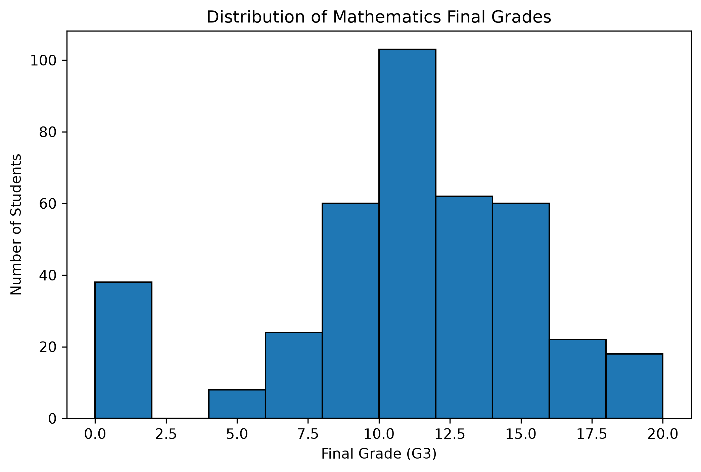

# Student Performance Analysis

## Project Overview

Student Performance Analysis is a data analysis project developed using Python. It explores student academic performance in Mathematics and Portuguese using data analysis libraries and visualization techniques.

The project uses the Student Performance dataset to examine final grades, study time, school absences, and relationships between selected variables.

## Project Objectives

- Analyze student performance in Mathematics and Portuguese.
- Calculate descriptive statistics for final grades.
- Visualize grade distributions using histograms.
- Compare average grades between subjects.
- Explore the relationship between study time and final grades.
- Investigate the relationship between school absences and academic performance.
- Analyze grade progression across three grading periods.
- Use a correlation heatmap to explore relationships between numerical variables.


## Technologies Used

| Technology | Purpose |
|---|---|
| Python | Main programming language |
| Pandas | Data loading, cleaning, and manipulation |
| NumPy | Numerical computing |
| Matplotlib | Creating charts and graphs |
| Seaborn | Statistical data visualization |
| Jupyter Notebook | Writing and executing analysis code |
| VS Code | Project development environment |

## Datasets

This project uses two CSV files:

- `student-mat.csv` — Mathematics student performance data.
- `student-por.csv` — Portuguese student performance data.

The datasets contain student information, study habits, school absences, and grades.

The `G1`, `G2`, and `G3` columns represent first-period, second-period, and final grades, respectively. Grades use a 0–20 scale.


## Project Features

- Dataset loading and inspection.
- Missing-value and duplicate-record checks.
- Grade validation.
- Descriptive statistical analysis.
- Mathematics and Portuguese grade comparison.
- Grade distribution histograms.
- Study-time analysis.
- Absence and grade relationship analysis.
- Grade progression visualization.
- Correlation heatmap.
- Summary statistics exported to CSV.
- Charts exported as PNG image files.

## Project Output

The project generates:

- A CSV summary report in the `data/` directory.
- Grade distribution charts.
- Average grade comparison chart.
- Study-time analysis chart.
- Absence and grade scatter plot.
- Grade progression chart.
- Correlation heatmap.

The charts are saved in the `visualizations/` directory when the relevant notebook cells are executed.


## Installation Requirements

Before running this project, make sure you have installed:

- Python 3.10 or a compatible version
- Visual Studio Code
- Jupyter extension for VS Code
- Python extension for VS Code

### Required Python Libraries

Install the required libraries using pip:

```bash
pip install pandas numpy matplotlib seaborn jupyter
```

## Project Setup

### 1. Download or Clone the Project

Download the project files and open the project folder in Visual Studio Code.

### 2. Open the Terminal

In VS Code, select **Terminal → New Terminal**.

### 3. Install Dependencies

Run the following command:

```bash
pip install pandas numpy matplotlib seaborn jupyter
```

### 4. Check the Project Structure

Make sure the files and folders are organized as follows:

```text
student-performance-analysis/
├── data/
│   ├── student-mat.csv
│   ├── student-por.csv
│   └── student_performance_summary.csv
├── notebooks/
│   └── student_performance_analysis.ipynb
├── visualizations/
└── README.md
```

The summary CSV and visualization images will be generated when their respective notebook cells are executed.


## How to Run the Project

1. Open the project folder in Visual Studio Code.
2. Open `notebooks/student_performance_analysis.ipynb`.
3. Select the Python environment or kernel that has the required libraries installed.
4. Execute the notebook cells in order, from top to bottom.
5. Review the displayed statistical results and charts.
6. Check the `data/` folder for the generated CSV summary.
7. Check the `visualizations/` folder for exported charts.

### Important Note About File Paths

The notebook uses relative paths such as `../data/student-mat.csv`.

These paths assume that the notebook's working directory is the `notebooks/` folder. If a file cannot be found, verify the notebook's current working directory and the location of the dataset files.


## Limitations

- The analysis is based on the available student records and variables.
- Correlation does not prove causation.
- Study time and free time are recorded as categories rather than exact hours.
- The Mathematics and Portuguese datasets have different numbers of records and should not automatically be treated as matched student records.
- The analysis does not establish that any single factor causes better or worse academic performance.

## Future Improvements

- Add interactive dashboards.
- Explore additional student and family characteristics.
- Compare more academic performance indicators.
- Develop a simple web dashboard using Streamlit.
- Add more detailed statistical analysis.
- Create a final report with automatically generated findings.

## Conclusion

This project demonstrates how Python can be used for data cleaning, exploratory data analysis, statistical summaries, and visualization.

It provides an opportunity to practice Pandas, NumPy, Matplotlib, and Seaborn while exploring patterns in student academic performance.
---

## 📊 Project Visualizations

### 1. Mathematics Grade Distribution


### 2. Portuguese Grade Distribution


### 3. Average Grade Comparison


### 4. Study Time vs Final Grade


### 5. Absences vs Final Grade


### 6. Student Grade Progression


### 7. Correlation Heatmap


